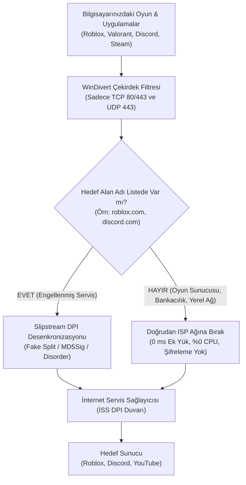

# ⚡ Slipstream

### Windows İçin Sıfır Gecikmeli (0 ms) & Sıfır FPS Kayıplı Çekirdek Düzeyi DPI Bypass ve Oyun Hızlandırıcı

  <b>Slipstream</b>; internet servis sağlayıcılarının (İSS) uyguladığı sansür, throttling ve DPI engellerini harici bir sunucuya bağlanmadan, IP adresinizi değiştirmeden ve <b>oyun içi gecikme (ping) eklemeden</b> aşmanızı sağlayan açık kaynaklı, ultra hafif bir Windows yardımcı programıdır.

[Kurulum](#-kurulum--kullanım) • [Oyun Modu Farkı](#-oyunlarda-fps-ve-gecikmeyi-nasıl-etkiler) • [Özellikler](#-öne-çıkan-özellikler) • [Desteklenen Platformlar](#-desteklenen-oyun-ve-platformlar) • [Mimari](#-çalışma-mantığı--mimari) • [SSS](#-sıkça-sorulan-sorular-sss)

---

## 🎮 Oyunlarda FPS ve Gecikmeyi Nasıl Etkiler?

Geleneksel bir VPN ile **Slipstream Düşük Gecikmeli Oyun & Ses Modu** arasındaki en temel farklar:

| Karşılaştırma Özelliği | 🌐 Standart VPN (WireGuard / OpenVPN) | ⚙️ Klasik DPI Araçları (GoodbyeDPI vb.) | ⚡ Slipstream (Standart Mod) | 🚀 Slipstream (Düşük Gecikmeli Oyun Modu + Süreç Önceliği) |
| :--- | :--- | :--- | :--- | :--- |
| **İşlemci (CPU) Yükü** | **%5 – %15 CPU** (Sürekli AES/ChaCha şifreleme ve tünelleme) | **<%0.5 CPU** (Yalnızca ilk el sıkışma paketleri) | **<%0.1 CPU** (Kernel düzeyinde pasif filtre) | **%0.0 CPU (Şifreleme Yok)** Oyun paketleri hiçbir gecikmeye uğramadan doğrudan akar. |
| **FPS & 1% Low Kararlılığı** | **FPS Düşürür:** CPU odaklı oyunlarda kare dalgalanmaları ve ani drop'lar yaratır | **Nötr:** FPS'i doğrudan etkilemez | **Nötr:** FPS'i doğrudan etkilemez | **FPS'i Dengeler & Korur:** Aktif oyun süreçlerine `HIGH_PRIORITY_CLASS` verilerek arka plan uygulamalarının CPU çalması engellenir. |
| **Gecikme (Ping)** | **+40 ms – +100 ms Ek Yük** (Trafik yurt dışı sunucularına dolanır) | **+1 ms – +3 ms** (Tüm TCP akışı kullanıcı alanında filtrelenir) | **0 ms Ek Yük** (Doğrudan yerel ISP hızında) | **0 ms Ek Yük (Maksimum Hız):** Doğrudan Türkiye ISP omurgasında, en yakın oyun sunucusuna bağlanır. |
| **Ağ Kuyruğu (Nagle)** | Paketler VPN sanal adaptör tamponunda bekletilir | Windows standart TCP kuyruğu aktiftir | Windows standart TCP kuyruğu aktiftir | **Nagle İptal (TCP NoDelay):** `TcpAckFrequency=1` ve `TCPNoDelay=1` ile paketler tamponlanmadan anında hatta sürülür. |
| **Windows Ağ Kısıtlaması** | Windows multimedya ağ kısıtlamasına tabidir | Kısıtlama aktiftir | Kısıtlama aktiftir | **Kısıtlama Tamamen Kaldırılır:** `NetworkThrottlingIndex=0xFFFFFFFF` ile ağ darboğazı sıfırlanır. |
| **Sistem İşlem Önceliği** | Sistem arka plan servislerine %20 CPU ayırır | Standart Windows varsayılanı (%20 ayrılmış) | Standart Windows varsayılanı | **%100 Oyun Odaklı:** `SystemResponsiveness=0` ile öncelik kesintisiz oyun paketlerine verilir. |
| **Oyun Süreç Öncelik Yönetimi** | Yok (Tüm trafiği ve sistemi aynı tünelden geçirir) | Yok | Yok | **Seçici ve Bağımsız:** SADECE aktif oyunlar (Roblox, Valorant, CS2 vb.) yüksek önceliğe alınır; Discord, Spotify gibi uygulamalara dokunulmaz. |
| **Discord Ses (RTC)** | Yüksek ping, ses kesilmesi ve gecikme yaşanabilir | STUN paketleri bozulabilir ("RTC Connecting" hatası) | UDP 443 hariç ses doğrudan akar | **30-40 ms Doğal Ping:** STUN el sıkışması bozulmaz, ses doğrudan en yakın Discord sunucusuna akar. |
| **IP & Konum Durumu** | IP değişir (Oyun matchmaking'i yabancı sunuculara atabilir) | IP değişmez (Yerel sunucular korunur) | IP değişmez (Yerel sunucular korunur) | **Yerel Türk Sunucuları:** IP değişmediği için Türkiye sunucularında en düşük ping ile eşleşilir. |

---

## 🚀 Öne Çıkan Özellikler

### 🛡️ 1. Sıfır Proxy, Sıfır Gecikme (Kernel Düzeyi DPI Desenkronizasyonu)
Slipstream bir proxy sunucusu veya VPN **değildir**. Windows Kernel sürücüsü (`WinDivert`) aracılığıyla yalnızca hedeflenen engelli alan adlarının ilk TCP/TLS el sıkışma paketlerini (SYN/ACK) hafifçe desenkronize eder (fake split, disorder, md5sig). Geriye kalan tüm veri akışı doğrudan ağ kartınız üzerinden **%100 doğal ISP hızında** akar.

### 🎮 2. Düşük Gecikmeli Oyun & Ses Modu (TCP NoDelay + Ağ Tweakleri)
* **Nagle Algoritması İptali:** `TcpAckFrequency=1` ve `TCPNoDelay=1` kayıt defteri optimizasyonlarıyla küçük oyun paketlerinin biriktirilmesi engellenir.
* **Multimedya Ağ Kısıtlaması (Network Throttling) İptali:** Windows'un arka planda ağ trafiğini kısması engellenir.
* **Sistem Tepkiselliği:** `SystemResponsiveness=0` ayarıyla CPU önceliği ön plandaki oyuna yönlendirilir.
* **RSS & TCP Auto-Tuning:** Çok çekirdekli paket işleme (`Receive Side Scaling`) otomatik etkinleştirilir.
* **Temiz Geri Yükleme:** Ayar kapatıldığında veya uygulama sonlandığında tüm değerler Windows fabrika varsayılanlarına temizce geri döner.

### ⚡ 3. Oyun Süreçlerine Yüksek İşlemci Önceliği (Bağımsız Ekstra Seçenek)
* Kullanıcıların sistemindeki süreçlerin izinsiz değiştirilmesini istemeyebileceği düşünülerek **ayrı bir anahtar** olarak tasarlanmıştır.
* **Sadece Oyun Odaklı:** Roblox, Valorant, Counter-Strike 2, Minecraft, Fortnite, League of Legends, GTA V gibi oyunlar açık olduğunda Windows işlemci zamanlayıcısında otomatik olarak `HIGH_PRIORITY_CLASS` moduna alınır.
* **Sıfır Çekirdek Çekişmesi:** Discord, Spotify, Steam istemcisi veya web tarayıcılarına **kesinlikle dokunulmaz (Normal modda bırakılır)**. Böylece arka plan uygulamaları oyunun render çekirdeklerini işgal etmez, mikro takılmalar (stutter) ve 1% Low FPS düşüşleri önlenir.

### 🧠 4. Canlı Oyun ve Süreç Tanıma
* Bilgisayarınızda arka planda çalışan süreçleri Toolhelp32 API ile gerçek zamanlı analiz eder.
* Listeden manuel alan adı veya uygulama aramanıza gerek kalmadan; Roblox, Valorant, Discord, Steam veya eklediğiniz özel oyunlar açıldığı an sistem tarafından otomatik olarak algılanır, listenin en tepesine taşınır ve koruma kuralları otomatik devreye girer.

### 💼 5. %100 Bağımsız Tek Dosya Portable (Taşınabilir) Sürüm
* `Slipstream-Portable.exe` dosyasını USB belleğe veya herhangi bir klasöre atıp doğrudan çalıştırabilirsiniz.
* Bulunduğu klasörde hiçbir yan dosya (`.sys`, `.dll`, `.txt`, ayar dosyası) **oluşturmaz**. Gerekli çekirdek bileşenleri `%LOCALAPPDATA%\Slipstream\engine\` dizininde izole olarak çalıştırılır.

### 🌐 6. Akıllı Alan Adı & CDN Öneri Sihirbazı
* Özel bir alan adı eklemek istediğinizde (örn: `kick.com` veya `epicgames.com`), o servisin kullandığı alt alan adlarını (CDN, API, giriş uç noktaları) anında analiz eder ve tek tıkla eksiksiz eklemenizi sağlar.

### 🔒 7. Tek Örnek (Single-Instance) Kilidi & Sessiz Güncelleme
* Arkada birden fazla Slipstream kopyasının açılarak WinDivert sürücüsünü kilitlemesi Windows Mutex mekanizmasıyla engellenir. İkinci kez tıklandığında mevcut açık pencere öne getirilir.
* Güncellemeler kullanıcı oyun oynarken veya film izlerken ekrana cmd ekranı açmadan, **alt-tab yaptırmadan arka planda sessizce** tamamlanır.

### 🔄 8. Otonom Kendi Kendini İyileştiren Sistem (Self-Healing Auto-Bypass)
* İnternet Servis Sağlayıcınız (Türk Telekom, Turkcell Superonline, Vodafone vb.) DPI filtreleme kurallarını değiştirdiğinde veya bağlantı engellendiğinde, arka plandaki otonom bekçi mekanizması durumu anında teşhis eder.
* Alternatif bypass stratejilerini test ederek çalışan en kararlı parametreye otomatik olarak geçer ve bağlantıyı kullanıcı müdahalesine gerek kalmadan anında onarır.

### 🎨 9. Gelişmiş Kişiselleştirme & Yeni Temalar
* Temiz ve kategorize edilmiş alt ayar sekmeleri (Genel, Gelişmiş, Kişiselleştirme) ile akıcı ayar yönetimi.
* Özel yeni temalar: **Erkek Rengi** (Kömür karası & fırçalanmış titanyum çelik), **Kan Kırmızı**, **Ametist Gece** ve **Buzul Arktik**.
* Platform kart yoğunluğu (Standart / Kompakt) ve ortam neon ışıma (Ambient Glow) tercihleri.

---

## 🎯 Desteklenen Oyun ve Platformlar

| Kategori | Platformlar ve Oyunlar | Durum |
| :--- | :--- | :---: |
| **Popüler Oyunlar** | 🎮 Roblox (Tüm oyunlar, stüdyo, client & CDN'ler), Valorant, CS2, Minecraft, Fortnite, LoL, GTA V, Battle.net | ✅ Aktif (0ms Ping) |
| **Ses & Topluluk** | 💬 Discord (Uygulama, ses kanalları 30-40ms RTC, güncelleyici relay, medya ve CDN'ler), Telegram, Signal | ✅ Aktif (Doğal Ses) |
| **Yayın & Medya** | ▶️ YouTube (4K Akış), Twitch, Kick, TikTok, Spotify | ✅ Aktif (Tam Hız) |
| **Sosyal Ağlar** | 📸 Instagram, Facebook, X (Twitter), Reddit, Wattpad, Ekşi Sözlük | ✅ Aktif (Kesintisiz) |
| **Geliştirici & Bilgi** | 💻 GitHub, GitLab, StackOverflow, Wikipedia, Tor Project, ProtonMail, Pastebin | ✅ Aktif (Temiz Erişim) |

---

## 🏗️ Çalışma Mantığı & Mimari

---

## 📦 Kurulum & Kullanım

Slipstream iki farklı kullanım seçeneği sunar:

### 1. Kurulumlu Sürüm (Önerilen)
1. [Releases](https://github.com/BaranK35/Slipstreamtest2/releases) sayfasından en son `Slipstream_x.x.x_x64-setup.exe` dosyasını indirin.
2. Kurulum sihirbazını tamamlayın.
3. Windows başlangıcında otomatik açılma, sistem tepsisine gizlenme ve otomatik güncelleme özellikleri kurulu olarak hazır gelir.

### 2. Taşınabilir (Portable) Sürüm
1. [Releases](https://github.com/BaranK35/Slipstreamtest2/releases) sayfasından `Slipstream-Portable.exe` dosyasını indirin.
2. İstediğiniz klasörden veya USB bellekten doğrudan çift tıklayarak çalıştırın.
3. Bulunduğu klasöre hiçbir dosya bırakmaz, temiz ve bağımsız çalışır.

---

## ❓ Sıkça Sorulan Sorular (SSS)

<b>1. Slipstream oyunlarda ban (yasaklanma) riski taşır mı?</b>

 
<b>Kesinlikle hayır.</b> Slipstream bir VPN değildir; IP adresinizi değiştirmez, harici şüpheli sunuculara bağlanmaz ve oyunların belleğine (memory/process injection) müdahale etmez. Anti-cheat yazılımları (Riot Vanguard, Easy Anti-Cheat, BattlEye) Slipstream'i bir hile veya VPN olarak algılamaz çünkü tüm oyun paketleri doğrudan resmi Türk sunucularına orijinal IP'nizle gider.

<b>2. "Oyun Süreçlerine Yüksek İşlemci Önceliği" neden uygulamaları kapsamaz?</b>

 
Eğer Discord veya Google Chrome gibi uygulamalara da oyunla aynı anda High Priority verilirse, arka plandaki ses kodlama veya tarayıcı iş parçacıkları oyunun render çekirdekleriyle rekabete girer. Bu durum oyunlarda anlık takılmalara (micro-stutter) ve 1% Low FPS düşüşlerine yol açar. Slipstream, sadece aktif 3D oyunları yüksek önceliğe alarak arka plan uygulamalarının işlemci gücünü bölmesini engeller.

<b>3. Antivirüs yazılımları neden uyarı verebilir?</b>

 
Slipstream, paket manipülasyonu yapabilmek için açık kaynaklı ve imzalı <code>WinDivert.sys</code> çekirdek sürücüsünü kullanır. Ağ paketlerini çekirdek düzeyinde denetleyen sürücüler bazı antivirüsler (Windows Defender, Kaspersky vb.) tarafından sezgisel olarak "bilinmeyen düşük seviyeli araç" olarak işaretlenebilir (False-Positive). Projenin tüm kaynak kodları GitHub üzerinde açıktır ve bağımsız olarak incelenebilir.

<b>4. Slipstream kapatıldığında internet ayarlarım bozulur mu?</b>

 
<b>Asla.</b> Slipstream temiz kapanış mimarisine sahiptir. Uygulamayı kapattığınızda veya durdurduğunuzda tüm DNS ayarları, proxy girdileri, hosts yönlendirmeleri, TCP NoDelay parametreleri ve süreç öncelikleri Windows'un orijinal fabrika ayarlarına anında geri döndürülür.

---

## 📄 Lisans

Bu proje [MIT Lisansı](LICENSE) altında dağıtılmaktadır. Çekirdek paket motorunda kullanılan WinDivert sürücüsü GNU LGPLv3 lisansına tabidir.
